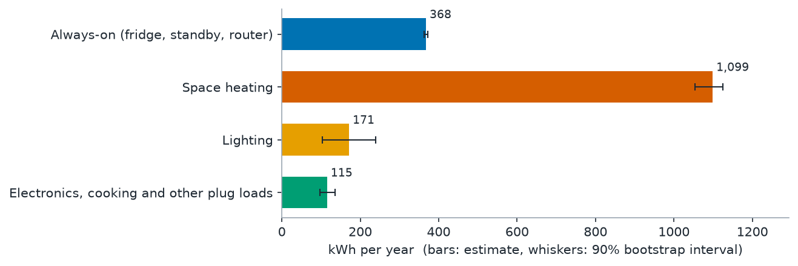
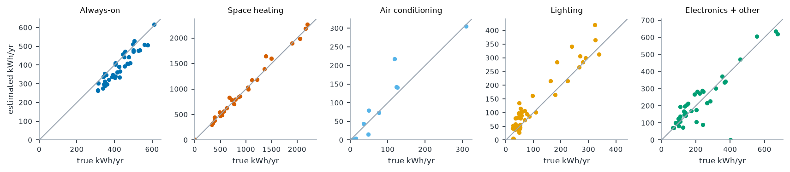

# Dorm Watt Watch

Most students who pay their own electric bill get one number a month. Dorm Watt Watch takes the
interval-usage file your utility already gives you (Green Button "Download My Data"), works out
where the energy goes (space heater, always-on load, lighting, electronics), and ranks the three
changes that save the most **kWh, dollars and kg CO2e per semester and per year**. Every number
comes with its method and a source.

The demo report from the shipped sample is [docs/index.html](docs/index.html). It opens straight from
disk, no server needed.



## Quick start

```bash
python3 -m venv .venv && . .venv/bin/activate
pip install -r requirements.txt
python -m dormwatt report data/sample_greenbutton.csv --checklist data/sample_checklist.json --out report.html
open report.html            # or double-click it
pytest -q                   # 19 tests
```

On the sample (one synthetic year, 15-minute readings, Ithaca NY), the run prints:

```
365 days, 1,753 kWh/yr. Grid NYUP: 0.115 kg CO2e/kWh; price $0.2926/kWh (NY).
  Always-on (fridge, standby, router)               368 kWh/yr  [363-373]
  Space heating                                    1099 kWh/yr  [1054-1125]
  Air conditioning                                    0 kWh/yr  [0-0]
  Lighting                                          171 kWh/yr  [103-240]
  Electronics, cooking and other plug loads         115 kWh/yr  [97-135]
Top 3:
  1. Swap incandescent and halogen bulbs for LEDs: 129 kWh/yr, $38/yr, 14.8 kg CO2e/yr (semester 68 kWh)
  2. Put the space heater on a thermostat timer: 110 kWh/yr, $32/yr, 12.6 kg CO2e/yr (semester 43 kWh)
  3. Let the computer sleep instead of idling: 58 kWh/yr, $17/yr, 6.6 kg CO2e/yr (semester 22 kWh)
```

Your own data:

```bash
python -m dormwatt report my_usage.csv --checklist my_checklist.json --temps my_temps.csv \
    --zip 14850 --state NY --out report.html --json report.json
```

Other commands: `python -m dormwatt validate --n 40` (re-run the accuracy test),
`python -m dormwatt demo` (rebuild `docs/`), `python -m dormwatt sample` (rebuild the sample).

### Inputs

**Usage CSV.** The header row is found automatically and any account preamble above it is skipped.
Two shapes are supported:

```
TYPE,DATE,START TIME,END TIME,USAGE (kWh),COST,NOTES          <- common utility export
Electric usage,2025-01-01,00:00,00:14,0.014,,
```
```
Interval Start,Consumption (kWh)                              <- one timestamp column
2025-01-01T00:00:00-05:00,0.42
```
5, 15, 30 or 60 minute intervals; ISO or US dates; a `UNITS` column of `Wh` is converted. Time
zones are dropped and times are read as local clock time. Readings are summed to clock hours;
hours with missing readings are left out of the fit.

**Temperature CSV** (optional, strongly recommended): `timestamp,temp_f` (or `temp_c`), hourly.
`data/ithaca_hourly_temp_2025.csv` is real 2025 Ithaca weather from Open-Meteo. Without it,
heating and cooling cannot be separated from other loads.

**Checklist JSON** (optional): see [data/sample_checklist.json](data/sample_checklist.json).
Fields: `zip`, `state`, `subregion`, `space_heater`, `window_ac`, `mini_fridge`,
`fridge_energy_star`, `lighting` (`incandescent|halogen|cfl|led|mixed|unknown`), `bulbs`,
`desktop_pc`, `pc_left_on_hours`, `pc_idle_watts`, `semester_start`, `semester_end`,
`latitude`, `longitude`, `timezone`.

## How it meets the judging criterion (measurable reduction)

Green Shift Hacks judges on how clearly a project reduces waste, emissions or resource use.
Dorm Watt Watch turns "save energy" into three specific actions for one specific household, each
with a number in kWh, dollars and kg CO2e, and shows the arithmetic:

| Saving for the sample household (Ithaca, NYUP grid) | per year | per fall semester |
|---|---|---|
| Electricity | **296 kWh** (17% of its 1,753 kWh) | 134 kWh |
| Money at 29.26 c/kWh (EIA, NY) | **$87** | $39 |
| CO2e, eGRID average rate (0.115 kg/kWh) | **34 kg** | 15 kg |
| CO2e, eGRID non-baseload rate (0.432 kg/kWh) | 128 kg | 58 kg |

Is the saving right? I fed the sample's *true* category energy (the simulator knows it) into the same
rules: they give 308 kWh/yr against the 296 estimated (4% apart), and the same three changes come out on
top. Across 40 test households the estimated top-three saving was off by a median 4% (80th percentile 9%).

The same 296 kWh avoids more CO2 on a dirtier grid: 128 kg in RFC West (Ohio) and 175 kg in
SERC Midwest (Missouri), from the same eGRID table. Upstate New York's grid is mostly hydro and
nuclear, which is why the Ithaca figure is small.

## Method

1. **Always-on load.** Days when nobody is home (breaks, weekends away) show up as days whose
   mean and peak stay near the lowest daily minimum. The always-on load is the mean hourly use on
   those days (sample: 42 W over 47 away days). With no away days, the median of each day's lowest
   hour is used instead, with a warning.
2. **Regression on physical drivers.** On home days, the hourly kWh above the always-on load is
   regressed with **non-negative least squares** (`scipy.optimize.nnls`) on:
   - heating: degree-hours below a balance point (chosen by least squares from 45-70 F) weighted by
     your activity level, the same for hours you are asleep, and a **monotone** response to the
     day's mean temperature (non-negative ramps at 35/45/55/65/72 F, so heating can only rise as it
     gets colder);
   - cooling: the mirror image (degree-hours above 68-80 F, ramps at 65/72/80 F), only if you have AC;
   - electronics and everything else: your weekly activity pattern (average above-baseload use for
     each of the 168 hours of the week on mild days, re-estimated three times with the weather parts
     removed), plus a meal-time shape.
   Each column is scaled to sum to 1, so each coefficient is "kWh over the period".
3. **Lighting, bottom-up.** Evening lights and evening electronics rise and fall together for a
   student who is only home after dark, so a whole-home meter cannot split them (I tried; the
   regression version is in the code as the fallback, with a warning). When you give a bulb count,
   lighting = bulbs x typical watts for the type x 0.75 on-share, in every hour the meter shows
   you up (50 Wh above the always-on load) while the sun is low at your location (sun position
   computed from NOAA's solar equations).
4. **Hour-by-hour shares.** Each hour's metered kWh is split in proportion to the fitted parts, so
   the categories always add up to the bill.
5. **Uncertainty.** A day-block bootstrap (200 resamples) gives 90% intervals for sampling noise.
6. **Savings.** Each option is (estimated kWh it affects) x (a reduction factor):

| Option | Factor | Source |
|---|---|---|
| Space heater on a thermostat timer | 10% of heating | DOE: setback of 7-10 F for 8 h/day saves as much as 10% a year |
| LEDs for incandescent/halogen | 75% of lighting | DOE: residential LEDs use at least 75% less energy |
| Computer sleep | idle hours x (idle W - 1.6 W) | ENERGY STAR desktops dataset (median sleep W); ENERGY STAR 15/30 min sleep defaults |
| Unplug the fridge over breaks | fridge kWh/day x away days | ENERGY STAR compact fridge dataset |
| ENERGY STAR mini-fridge | fridge kWh/yr - 228 kWh/yr | ENERGY STAR compact fridge dataset |
| AC setpoint | 10% of cooling | DOE thermostat figure |
| Standby power strip | 25% of non-fridge always-on | **assumption** |

   Money uses the EIA state residential price. CO2e uses the eGRID subregion total output rate
   divided by (1 - grid gross loss), because a kWh at the meter needs a little more than a kWh at
   the plant. The non-baseload rate is shown as the upper figure.

## Accuracy (validation)

There is no small, freely downloadable labelled dataset of student apartments, so I built a
minute-by-minute simulator ([dormwatt/synth.py](dormwatt/synth.py)) and scored the estimator on 40
households it never saw the schedules of: a fridge compressor cycling on a duty that rises with room
temperature, a 900 or 1500 W space heater and a window AC on a thermostat driven by a first-order
room model fed with real 2025 Ithaca weather, lights that come on when you are up after dark, gaming
PCs, TVs, microwaves, kettles and hair dryers at random times, classes, nights out and school breaks.
Results are in [docs/validation.json](docs/validation.json) (`python -m dormwatt validate --n 40`).

Median absolute error per category, full year, 15-minute data (households that have the category):

| Category | Median error | 80th percentile | Mean abs. error | Fall semester only | No-meter guess |
|---|---|---|---|---|---|
| Space heating (n=26) | **4%** | 9% | 31 kWh | 3% | 34% |
| Always-on (n=40) | **11%** (reads low) | 15% | 40 kWh | 9% | 19% |
| Electronics + other (n=40) | **19%** | 38% | 47 kWh | 21% | 55% |
| Lighting (n=40) | **32%** | 78% | 31 kWh | 12% | 212% |
| Air conditioning (n=8) | 20% | 65% | 6 kWh | 37% (n=2) | 47% |
| **Top-three saving** | **4%** | 9% | | 6% | |



Hourly data does as well as 15-minute data (the model works on hours). The "no-meter guess" splits
the same total by fixed typical shares; the meter-based estimate beats it everywhere.

**Read these honestly.** They are errors against a simulator I wrote, so real homes will do worse.
The lighting test is optimistic, because the simulator and the estimator share the assumption that
lights are on when you are up after dark. The always-on load reads about 10% low because fridges
work less in a cold, empty room over winter break. The bootstrap intervals cover only day-to-day noise:
they contain the true value 12-70% of the time depending on the category, so treat the "typical error"
column in the report as the real error bar.

**The sample household.** Its seed was picked by a fixed rule: of 20 candidate households with the
sample's checklist (seeds 0-19), the 3-bulb one closest to the median error. Its estimate against the
truth in [data/sample_truth.json](data/sample_truth.json): always-on 368 vs 432 kWh (-15%), heating
1,099 vs 969 (+13%), lighting 171 vs 140 (+22%), electronics 115 vs 212 (-46%).

## Limits

- A whole-home meter cannot see individual devices. Devices that share a pattern (TV vs. PC,
  cooking vs. chargers) are grouped.
- Heating is identified only through its link to outdoor temperature. A heater that runs whatever
  the weather looks like any other plug load, and a file with only cold months cannot separate a
  heater's steady part from plug loads (the tool warns).
- Lighting depends on the bulb count and type you enter; bulb wattages (60/43/14/9 W), the 0.75
  on-share and the 50 Wh "someone is up" threshold are assumptions.
- The fridge/standby split inside the always-on load is a prior from the ENERGY STAR compact fridge
  data (federal-standard median 284 kWh/yr, capped at 80% of the always-on load), not a measurement.
- Applying DOE's 10% thermostat setback figure to a space heater, the 25% standby cut and the 60 W PC
  idle default are assumptions and are labelled as such in the report.
- Accuracy was measured on simulated households, not labelled real homes.
- CO2 uses annual-average eGRID2023 rates, not hour-by-hour grid intensity. Price is the state
  average from EIA, not your tariff. Per-year figures scale the data period to 365 days.
- Multi-subregion ZIP codes use EPA's first listed subregion; pass `--subregion` to choose another.

## Data and sources

All fetched with curl on 2026-10-28; `scripts/fetch_sources.sh` re-downloads them and rebuilds
`data/factors/` with `scripts/build_factors.py` (needs `pip install openpyxl`).

| What | Value used | Source (vintage) |
|---|---|---|
| CO2e rate, NYUP | 242.776 lb/MWh total output; 911.786 lb/MWh non-baseload; grid gross loss 4.2% | EPA eGRID2023 rev2 via Power Profiler ZIP tool v14.3, released 2025-06-12: https://www.epa.gov/system/files/documents/2025-06/power_profiler_zipcode_tool_v14.3.xlsx and summary tables https://www.epa.gov/system/files/documents/2025-06/summary_tables_rev2.xlsx |
| ZIP to eGRID subregion | 41,588 ZIPs | same Power Profiler ZIP tool |
| Residential price, NY | 29.26 c/kWh (all states in `data/factors/eia_residential_price.csv`) | EIA Electric Power Monthly Table 5.6.B, year-to-date through August 2026: https://www.eia.gov/electricity/monthly/epm_table_grapher.php?t=epmt_5_6_b |
| Compact fridge energy | ENERGY STAR median 228 kWh/yr; federal-standard median 284 kWh/yr (914 models, 2.5-4.5 cu ft) | ENERGY STAR Certified Residential Refrigerators: https://data.energystar.gov/resource/p5st-her9.json |
| Desktop sleep power | 1.6 W median (302 models) | ENERGY STAR Certified Computers V9.0: https://data.energystar.gov/resource/rxdj-2c88.json |
| Computer sleep defaults | display 15 min, system 30 min | https://www.energystar.gov/products/computers |
| LED vs incandescent | at least 75% less energy | DOE Energy Saver, archived 2025-06-02 (live page now 404): https://web.archive.org/web/20250602190837/https://www.energy.gov/energysaver/led-lighting |
| Thermostat setback | as much as 10% a year for 7-10 F, 8 h/day | DOE Energy Saver, archived 2022-01-27 (live page now 404): https://web.archive.org/web/20220127160056/https://www.energy.gov/energysaver/thermostats |
| Room AC (reference) | ENERGY STAR 5-8k Btu/h models: median 38% below federal standard | https://data.energystar.gov/resource/5xn2-dv4h.json |
| Weather | hourly 2 m temperature, Ithaca 2025 (CC BY 4.0) | Open-Meteo Historical Weather API |

`data/sample_greenbutton.csv` is synthetic (made by `python -m dormwatt sample`); it contains no
real customer data.

## Tech stack

Python 3.10+, NumPy, SciPy (`nnls`), Matplotlib. No machine learning frameworks, no GPU, no network
access at run time. The report is one self-contained HTML file with charts embedded as PNG, so it
works from `file://` and on GitHub Pages (`docs/`).

```
dormwatt/
  io.py           Green Button CSV and weather parsing, hourly resampling
  solar.py        sun elevation (NOAA equations) -> darkness signal
  disaggregate.py baseload, NNLS regression, bottom-up lighting, bootstrap
  recommend.py    savings rules with sources and labelled assumptions
  factors.py      eGRID, EIA and ENERGY STAR tables; ZIP -> subregion
  synth.py        minute-level synthetic households for validation
  validate.py     scoring against known truth
  report.py       HTML report and charts
  cli.py          python -m dormwatt report | validate | sample | demo
```

## License

MIT, see [LICENSE](LICENSE).
